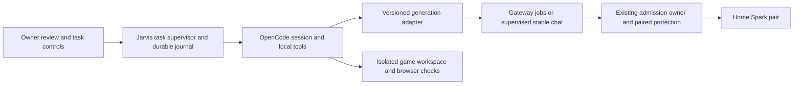

# Long running Spark coding proposal

Date: 19 October 2026. Status: final design reviews complete; ready for owner review. Implementation and live trials require the owner's go.

Use Jarvis to run one checkpointed coding task at a time, with low reasoning and small, bounded generations on the protected home Spark pair. OpenCode owns the repository, tools, tests and task history; the gateway owns admission and generation jobs. An hours-long task consists of many short steps with saved results. It does not require an hours-long inference request.

The gateway, thermal and monitoring sessions agree with this architecture and the staged gates below. The proposed acceptance task is to finish the existing Batman versus Iron Man browser game. No game, harness, gateway, client configuration or infrastructure implementation is part of this review.

## What exists and what needs work

| Layer | Established baseline | Gap for unattended coding |
| --- | --- | --- |
| Home inference | GLM-5.3-Flash-EXL3 on TensorFold across alpha and beta; one physical resource group | Sustained representative coding throughput and thermal stability have not been accepted |
| Interactive gateway | One active slot, eight waiting requests; 180 seconds queue, 300 seconds active | Requests do not survive restart; a broken response can hide execution |
| Durable generations | Explicit jobs API, one nonstreaming generation per job; 60 seconds active, 2,048 output tokens, 25 pending globally | Stock OpenCode does not use it; a generation result does not preserve the whole coding task |
| Context | 24,576 input, 8,192 output, 32,768 combined tokens | Growing history, tool definitions and tool results can exhaust input before the task ends |
| Jarvis harness | Installed OpenCode 1.19.3; existing gateway provider | Current local provider timers are 400 seconds total and 75 seconds between chunks; outer retry behavior needs a proven gate |
| Protection | Single admission owner, paired guards, cancellation reconciliation and bounded recovery | No second scheduler, client recovery loop or longer timeout can override these |

Sources: gateway [onboarding](../../../tooling/sparks/docs/onboarding.md), [settings](../../../tooling/sparks/src/sparks/config.py), [jobs](../../../tooling/sparks/src/sparks/jobs.py) and [release status](../../../tooling/sparks/docs/implementation-status.md). These describe deployed limits and historical acceptance, not current readiness.

Job execution time includes guard acquisition, backend checks, tokenization and prefill, as well as generation. The output allowance is a ceiling, not a promise of 2,048 tokens within 60 seconds. Both job caps are enforced as code/schema maxima; increasing them needs a reviewed gateway release, not just a client or configuration edit.

Queued jobs survive gateway restart; dispatched jobs become `uncertain` and are not replayed. Queue expiry is 24 hours, successful results last seven days, and idempotency records last 30 days. The shared jobs key permits retrieval/cancellation of other retained household jobs; keep it private to the runner. Full local gateway capture remains enabled. Public job metadata is not a repository or task-progress dashboard.

## Options and recommendation

| Option | Useful for | Decision |
| --- | --- | --- |
| Headless OpenCode with stable chat and a process supervisor | Establishing real coding quality; surviving terminal disconnection while the process remains alive | First supervised baseline, after retry safety is proven; no crash-durability claim |
| OpenCode with durable generation adapter and task journal | Restart-aware, hours-long edit/test loops using idle-first capacity | Target architecture |
| Standalone jobs helper | Independent drafts, plan sketches and other single generations | Useful optional utility; does not build a game by itself |
| Separate minimal coding harness around jobs | Smaller integration surface if OpenCode cannot expose safe retry/tool boundaries | Contingency; prefer reusing OpenCode's tools, permissions and UI |
| New serving engine, model or office pair | Potential later throughput improvements or independent capacity | Separate benchmark/deployment decision; not a prerequisite |

Start with an external supervisor and a version-pinned OpenCode extension/provider adapter. Inspect available hooks before choosing the integration seam. If hooks cannot control the outer inference retry loop or journal tool boundaries reliably, make the smallest provider-scoped upstreamable OpenCode change. A broad permanent fork is unnecessary at this stage. Adapter feasibility is a phase gate, not an existing capability.

OpenCode already documents headless [server sessions](https://opencode.ai/docs/server/) and an [SDK](https://opencode.ai/docs/sdk/). Those provide process/session control and observation; they do not establish restart-safe tool execution.

## Ownership and execution

The supervisor leases the task workspace to one writer. This task lease is separate from gateway admission and cannot reserve or control GPUs. Start one run and one outstanding dependent generation at a time. Release inference capacity while tools, browser checks and tests run. Batches are for independent generations, not dependent coding turns. Disable auxiliary title/summary requests or route them through the same serialized adapter and budgets; model-assisted compaction is also inference.

The durable adapter translates a model turn into the explicit jobs contract, polls its retained status and returns the complete result to OpenCode. Preserve tool-call IDs, reasoning fields, finish reason and usage. Nonstreaming jobs have no live token stream: expose queued/running status separately and never invent token output to keep a UI alive. Ordinary stable `/v1/chat/completions` retains its existing behavior. No new `/experimental/v1` availability is implied.

Persist these boundaries before advancing:

1. Task ID, workspace snapshot/revision, checkpoint, selected exact model, harness/adapter versions and remaining budgets.
2. Generation intent with exact request, body hash and idempotency key **before sending**; then the accepted gateway job ID.
3. Complete downloaded generation result and its finish reason, before executing any returned tool.
4. Tool intent, arguments, preconditions and tool-call ID before execution; tool result and resulting workspace state afterward.
5. Validation outcome and next checkpoint. Resume by reconciling this state rather than asking the model to start over.

A crash after a tool changes a file but before its result is saved cannot be solved by a journal alone. Compare recorded preconditions, file hashes/diffs and tool effects. Repeat only operations proven safe; ambiguous edits or shell effects pause for review. Do not claim exactly-once arbitrary shell execution. Reject incomplete/truncated tool arguments and partial edits; a successful job with `finish_reason:length` is not a completed coding step.

## Retry and cancellation contract

The version-matched upstream OpenCode 1.19.3 source allows five session retries and treats 5xx errors as retryable even if an error says otherwise. Its SDK call sets a separate retry count. Therefore SDK `maxRetries=0` alone is insufficient. This is a source finding, not a live fault-injection result for the installed binary. See pinned [session retry](https://github.com/anomalyco/opencode/blob/e3c4eb242585dcd77be1a867391b7c25fd47ce52/packages/opencode/src/session/retry.ts) and [LLM call](https://github.com/anomalyco/opencode/blob/e3c4eb242585dcd77be1a867391b7c25fd47ce52/packages/opencode/src/session/llm.ts).

| Outcome | Runner behavior |
| --- | --- |
| Job submission response lost | Reconcile by identical body and the same persisted idempotency key; never create a fresh key automatically |
| Known queued/running job | Poll the same ID with bounded backoff; do not submit a replacement |
| Complete successful result | Save locally once, then process validated tool calls |
| Explicit rejection proven before dispatch | Bounded retry only for an eligible temporary rejection, respecting backoff and the task deadline |
| Broken chat stream, 504, ambiguous dispatch or `uncertain` | Pause and reconcile; no implicit inference resubmission or cloud fallback |
| Task cancellation/deadline | Stop new turns, cancel its known job, reconcile tools; do not call the task fully cancelled while execution is unresolved |
| Cooling, unsafe, stale telemetry or review latch | Record the blocked reason; wait or stop within task budget; never clear latches/restart services |

Preserve request IDs and gateway error reasons. Reconciliation never releases a GPU reservation from the client side: only the gateway may do that after confirming backend idle. If no safe per-provider retry hook exists, the narrow core retry seam must precede any live baseline. Other providers keep their own policy.

## Applying the low and slow operating suggestions

- Serialize this workload. Additional agents/sessions add queue contention, not home GPU capacity. Keep foreground hosted work on a deliberately selected per-session provider such as the existing ZAI coding provider, subject to the owner's account limits; no automatic paid overflow. Hosted selection requires the applicable provider data/cost consent and budget; it is not a deployed gateway route.
- Use the configured low reasoning variant and a fresh session per task. Bound tool output, read relevant file ranges, save facts/checkpoints outside conversation history, and compact before the input limit. Include tool schemas/system text in the context budget. Start compaction around 16,000 estimated input tokens, leaving margin for the next tool result; exact gateway token validation remains authoritative. Compaction must retain requirements, checkpoint/job/tool identities and unresolved effects; any model-assisted compaction uses the same protected inference budget.
- For current chat, use the maintained example's 600-second total and chunk ceilings after checking every proxy/watchdog layer. This accommodates the documented 180+300-second envelope plus cleanup; it does not lengthen server execution. Durable polling has its own task deadline and must not inherit a single chat-call timeout.
- Validate commands against the installed version. Jarvis 1.19.3 help supports `run`, `--model`, `--variant`, `--session`, `--attach` and `serve`, but lacks `--standalone`. Keep 2.0.32 examples separate. Do not assume `#low` model syntax or `--standalone` works locally; pin and validate the chosen command/configuration before use.
- Check public `GET /v1/jobs` for retained job states, then authenticated readiness/status for actual admission and safety. This is a durable-queue snapshot, not an interactive-backlog check or an atomic reservation. Job-list availability or an empty queue does not prove inference is ready. Never publish a key in a command line or log.

Proposed pilot budgets: six hours elapsed including waiting, at most one hour accumulated active-request time, 100 generations, three repair attempts for the same failed check, and three minutes per ordinary tool invocation. Stop at the first exhausted budget and return the latest checkpoint/diff. These are proposed pilot defaults, not configured limits. Use smaller budgets for initial supervised checks. Pause after 15 minutes without a completed generation/tool/test while runnable; classify queued/cooling time separately, still counting it toward the elapsed deadline. Persist token totals and enforce per-turn limits; cumulative active time also bounds slow reasoning. Reserve against remaining budgets before dispatch, using the full active ceiling when exact consumed time is unavailable. Low reasoning does not guarantee thermal stability or a completed turn within current job caps. Repeated truncation or timeouts pause for task decomposition/profile review rather than endless continuation. No publication, deployment, push or unrelated repository changes are part of the game task.

## Game acceptance workload

The fixture is [index.html](../index.html), 318 lines, SHA-256 `36deb3d987df34f70a98129853ccdf84b17845055eda32b0667e96603ba2afe7`. It contains menu/selection/KO markup, input mappings, synth sounds, effects and background painting, then ends with “chunk 2 continues below.” There is no frame loop, fighter implementation or menu button wiring. This does not establish why the original file is incomplete.

Complete the existing browser game in small checkpoints, preserving its comic style and controls:

1. Wire menu, one/two-player selection, hero selection, countdown and a visible running arena.
2. Add drawn fighters, movement, jumping, facing and arena bounds.
3. Add punch/block/special behavior, hit detection, bounded cooldowns and visible health.
4. Add the single-player opponent, KO, rematch and return-to-menu transitions.
5. Check input reset on blur, resizing, both control sets, sound activation and console errors; repair failures within budget.

The single-player opponent and exact combat balance are implementation assumptions derived from the scaffold, not a separate supplied specification. Freeze a small deterministic browser acceptance suite before comparing runs. Verify both hero selections, both play modes, damage/block/special effects, KO/rematch/menu and repeated input/resize behavior. Save screenshots, console output, test results and the final diff for owner review. Browser screenshots can be reviewed locally; the current model accepts text only, so do not assume it can inspect images. No generated art or new service dependency is required.

Use an isolated copy/worktree with the same starting fixture for each comparison. The Git root is the parent `games` repository; do not let the trial rewrite sibling games or publishing files. Successful acceptance means a playable game and passing checks, not merely an exited agent or successful generation count.

## Implementation sequence after owner approval

| Phase | Work | Gate to continue |
| --- | --- | --- |
| 0: retry proof | Pin the client/source; inspect extension seams; fake-upstream tests for 502/503/504, disconnects before/after partial tool output and lost job acceptance | Count actual submissions; no implicit ambiguous redispatch; same-key job reconciliation; preserve cancellation/errors |
| 1: supervised baseline | Correct isolated client timers/low variant; short text/read-tool round trip, then bounded edits/tests on a fixture and game copy | Observe real valid tool turns, completion/truncation rates, input size and elapsed time; no crash-durability claim |
| 2: durable harness | Adapter, journal, task lease, checkpoint/resume and tool-effect reconciliation | Mock crashes at every persistence boundary; lost reply/result expiry/cancel cases pass; context and budget stops work |
| 3: workload fit | Measure representative small turns within current 60s/2,048-token jobs | If they do not fit reliably, split work or separately review a bounded coding-job profile with gateway code/schema/tests/onboarding changes |
| 4: sustained acceptance | Staged short ramp, then approximately two hours at representative duty including at least 30 minutes of stable thermal trend | Meet the thermal, progress and fairness criteria below; extend/review if still warming |
| 5: longer run | Extend toward the intended six-hour/overnight task duration with retained checkpoints and bounded budgets | Owner accepts measured results before unattended use |

Do not raise job deadlines to several minutes just to fit a full-file answer. Longer nonpreemptible jobs increase household latency. Preserve the existing idle-first/background turn after four actual interactive dispatches, and measure foreground queue impact. A background turn cannot be preempted by a new interactive request.

Any changed gateway capability/limit needs its normal release tests, privacy/retention review, versioned onboarding/API/inventory and LAN/Tailscale verification. No paid route, classifier, new endpoint, tool-execution permission or monitor credential expansion follows from this proposal.

## Thermal and observability gates

The thermal session's read-only check at **14:00:06 SGT on 19 October** reported ready/idle, healthy/unlatched ranks and guards, but **three recovery attempts used and zero remaining**. The first allowance slot was approximately **22:50:59 SGT**. This is a timestamped observation, not launch authorization or a future readiness guarantee. An exhaustion latch still needs review after allowance ages out. Require fresh paired readiness and recovery-budget assessment before proposing a trial.

Freeze the serving/client versions, physical roles, workload, context/output profile and duty cycle. Record placement/airflow and ambient observations where available. Run normal representative work, without forcing overheating, faults or recovery. During the staged acceptance, stop workload escalation on protective pause/closure, fault, active thermal throttling, stale/unknown telemetry or uncertain execution. Use normal cancellation and preserve evidence.

Acceptance requires stable trends, continuing completed tool/test checkpoints, no protective-stop/restart cycle and no recovery charge. The proposed operating margin is per-zone medians below 100 °C and median signed GPU headroom above 5 °C. These are pilot acceptance margins, not new guard settings. Time elapsed alone is not a thermal plateau.

Collect synchronized raw/named-zone readings, valid 20-second medians and `thermal.ready`, observed firmware trips, signed GPU headroom, active slowdown flags and reset-aware counter deltas, clocks/power, memory/PSI, SSD/ConnectX health, source age and recovery state. Keep observed firmware shutdown trips separate from sustained operating targets and guard thresholds. See [monitoring contract](../../../tooling/sparks/docs/monitoring-api.md).

Track useful completed tool turns/checkpoints and passing checks per wall-hour, truncations/timeouts, queue and occupied time, closure time by reason, and unknown intervals. Job wall duration is not TTFT/prefill/decode latency: report those phases only when actual measurements exist. Distinguish task lifecycle from availability and show last completed checkpoint/progress time; a heartbeat only proves the runner is alive. Queued status is not proof of forward progress.

Sampled monitoring cannot prove every one-second guard observation. Report scrape gaps/coverage and approximate closed minutes unless transition timestamps establish exact intervals. Correlate run/job/request/tool IDs in restricted journals/traces, never as metric labels or monitor prompt/code content. Existing monitor displays lag contract 5; sanitized local read-only collection can support the pilot without deploying a monitor change. A future harness feed needs separately approved pull-based onboarding.

## Serving options kept separate

First measure task quality, prefill cost, useful completed steps and sustainable duty on the home pair. Then compare smaller context/output, lower reasoning and pacing before considering backend acceleration. Prefix caching or speculative decoding needs exact serving-build support, checkpoint/draft compatibility, quality/tool correctness, memory/thermal benefit and rollback evidence. Neither is an established remedy here.

The future office QSFP-linked pair is an independent lab in the existing [office plan](../../../tooling/sparks/plans/2026-10-19-office-sparks-wifi-lab.md), not available extra home capacity. It needs its own local admission owner, paired protection and qualified engine execution/tokenization/cancellation adapter. Wi-Fi/Tailscale carries remote requests; it is not a distributed-model or home-guard link. Office deployment and model changes remain separate approvals. The home head/worker role swap is explicitly deferred.

## Cross session review record

Design discussions used the existing Codex thread messaging tools; no additional coding agents were created by this coordinator. All three reviewers explicitly agreed to the complete proposal, including the auxiliary-inference and no-progress safeguards, with no blocking corrections in their scopes.

| Reviewer | Scope and agreement |
| --- | --- |
| Gateway deployment session `01a14ac7-0946-70f3-be19-0f130cf3e2c8` | Endorses supervised baseline followed by durable adapter/journal; requires retry proof before baseline, measured job-profile fit and separate office/backend work |
| Thermal and gateway session `01a1527b-fe61-79a0-ad67-14fb38fe8ff0` | Agrees on the same admission/safety boundary; requires staged sustained acceptance and fresh recovery assessment; rejects an unmeasured hours-long reliability claim |
| Monitoring session `01a152aa-6cf6-7843-9c7e-aadb84ddf121` | Agrees on separate lifecycle/availability/progress, correlation, sampling limits and read-only evidence gates; monitor changes remain outside this review |
| Harness and game coordinator `01a152b9-e622-77f3-a6ef-64c57a207876` | Owns this proposal and future harness/game acceptance design |

The review decision is to approve or revise this phased direction. Numeric job-profile changes and unattended reliability remain conditional on the measured gates; no existing agreement claims they are already accepted.
